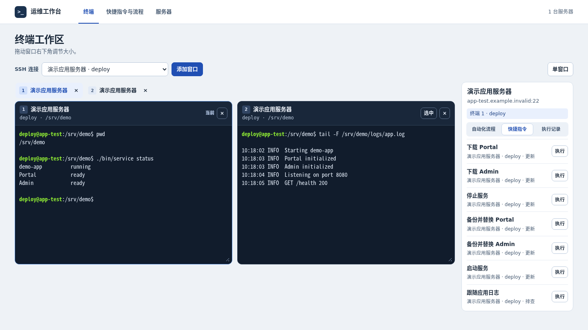
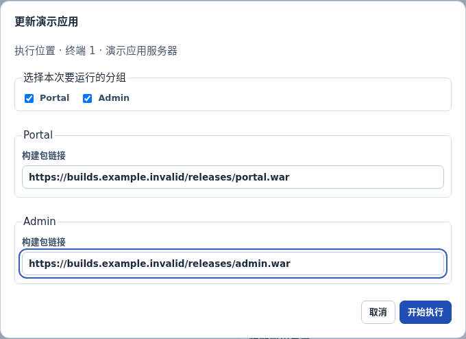

# SSH Workbench · 运维工作台

这个工具起于我自己的运维痛点。每次部署、更新或排查，都要重新打开终端，连服务器或跳板机，切换用户、进入目录，再一条条敲命令。碰到一个服务要换多个包，还得记得这次该停哪些服务、换哪些文件、启动后去哪里看日志。重复操作多了，哪怕只漏一步或者进错目录，也要花时间排查。

SSH Workbench 把这些操作留在熟悉的终端里。第一次照常手动操作，把常用命令存下来。下一次在选中的终端点「执行」，或者把几条指令组成流程，只选本次要更新的包。执行结果和日志都直接显示在终端里，需要输入或排查时可以继续手动操作。



本文截图均使用演示数据。

## 第一次使用

### 1. 打开终端

1. 进入「服务器」，点击「添加 SSH 连接」，填写名称、主机、端口和 SSH 登录用户。主机可以填域名或 IP。使用 SSH 密钥时沿用工作台运行用户的 OpenSSH 配置。使用密码时，可在连接里保存「SSH 登录密码」，也可在终端按提示输入。首次连接时，在终端核对主机指纹。
2. 在服务器列表点击「连接」，或回到「终端」选中连接后点击「添加窗口」。部署者启用了「本机终端」时，也可以直接打开工作台所在主机的 Bash。
3. 可以打开多个窗口，点标签或窗口内的「选中」切换当前终端。「平铺窗口」用于并排查看，「单窗口」用于聚焦一个终端。拖动窗口右下角可以调节大小。关闭一个窗口后，下次会优先复用空出的最小编号。

### 2. 把常用命令保存下来

1. 在终端执行一条命令，例如 `pwd` 或 `cd /srv/demo`。等 Bash 回到命令提示符。
2. 在右侧打开「执行记录」，找到那条命令，点「保存为快捷指令」。给它起个容易辨认的名字。编辑框会带入这次运行的用户、工作目录和命令，也可以直接在「快捷指令与流程」里新建。
3. 下次选中同一连接对应的终端，在右侧「快捷指令」中点「执行」。指令会在当前选中的 Bash 里运行。比如执行一次 `cd /srv/demo` 后，接着手动输入 `pwd`，会看到新目录。

**把每次会变化的值做成参数。** 例如先输入下面的下载命令。选中完整的示例链接，点击「把选中的内容设为参数」，参数名填 `buildUrl`，提示填「构建包链接」。

```bash
wget -O /var/tmp/portal.war https://builds.example.invalid/releases/portal.war
```

命令会变成 `wget -O /var/tmp/portal.war {{buildUrl}}`。以后每次点「执行」，填入本次的真实链接即可。参数会作为一个 Shell 参数传入。


### 3. 把更新步骤组成流程

在「快捷指令与流程」点击「新建自动化流程」。选定连接，按顺序加入该连接上同一执行用户的快捷指令。拖动每步左侧的把手可调整顺序。已有流程可以点「复制」，然后编辑副本。

假设一个服务下有 Portal 和 Admin 两个构建包，停服和启动由两个包共用。可以把同一包的步骤填成同一个分组名，公共步骤的分组留空。

| 顺序 | 快捷指令 | 分组 |
| --- | --- | --- |
| 1 | 下载 Portal | Portal |
| 2 | 下载 Admin | Admin |
| 3 | 停止服务 | 留空 |
| 4 | 备份并替换 Portal | Portal |
| 5 | 备份并替换 Admin | Admin |
| 6 | 启动服务 | 留空 |

这是一个编排示例。下载、备份、替换和启动分别用你自己的快捷指令实现。按上面的顺序，选中的下载步骤先执行，下载报错会停在当前步骤。


**运行时只选本次要更新的包。**

- 只选 **Portal** 时，只需填写 Portal 的构建包链接。执行顺序是下载 Portal、停服、备份并替换 Portal、启动服务。
- 两组都选时，Portal 和 Admin 各填自己的构建包链接。两个下载指令都可以使用名为 `buildUrl` 的参数，每组有独立的值。公共步骤各执行一次。
- 流程完全没有分组时，直接按原顺序执行。公共步骤的同名参数只填一次，同一分组内的同名参数也只填一次。



## 跳板机、密码和需要输入的命令

- **通过跳板机登录**。先打开跳板机终端，再照常输入 `ssh deploy@app-test.example.invalid`、`ssh deploy@192.0.2.20`，或用 `ssh -p 2222 deploy@app-test.example.invalid` 指定端口。目标 Bash 就绪后，右侧会切换到目标连接。首次将目标上的命令保存为快捷指令时，会一并保存该连接。同一路径登录可以复用指令，输入 `exit` 返回上一层。附带远程命令或其它选项的 SSH 调用按 OpenSSH 的方式运行。
- **保存登录后的密码输入**。把交互式二次 SSH 或 `su - appuser` 保存为快捷指令，在「下一步输入」里填写密码。遇到匹配的密码提示时会尝试自动填写一次。手动输入同一路径的二次 SSH 命令时，主机、端口和账号匹配且已保存的密码唯一，也可自动填写。编辑时会看到圆点和「已保存」，点击「显示」可查看或更换。
- **回答自定义提示**。例如程序会显示 `Continue? [y/N]`，将它填入「自定义提示」，选择「自动输入」，再把「下一步输入」设为 `y`。如果内容每次都不同，选「提示我手动输入」，等终端显示等待提示后继续输入。程序自身可能回显输入。

## 边更新边看日志

在另外一个终端打开日志，例如执行 `tail -F /srv/demo/logs/app.log`。将两个窗口平铺，然后选中部署终端执行流程。日志窗口显示命令原始输出，可继续观察服务启动。如果把 `tail -F` 放进流程里，该步骤会持续运行，直到你结束日志跟随。

流程遇到失败会停在当前步骤。需要应答或排查时，点「接管终端」，也可以用 `Ctrl+C` 中断。处理完后，可以点「重试本步」「本步已完成，继续」或「结束流程」。流程成功提示约 5 秒后收起。刷新页面可以接回仍在运行的终端，工作台进程重启后需要重新连接。

## 安装和部署

需要 Linux、Python 3.10+、Node.js/npm 和 OpenSSH 客户端。SSH 目标需要 Bash 和常见的 coreutils，切换账号使用 util-linux 的 `su`。

```sh
python3 -m venv .venv
. .venv/bin/activate
python -m pip install -r requirements.txt
npm ci --prefix ui
python workbench.py set-password
python workbench.py
```

用账号 `admin` 和刚设置的密码登录本机工作台。 [打开本机工作台](http://127.0.0.1:14441/)

| 配置 | 用途 |
| --- | --- |
| `WORKBENCH_PORT` | HTTP 或 HTTPS 端口，默认 `14441` |
| `WORKBENCH_DATA_DIR` | 默认用 `.data/` 保存配置和凭据。目录归运行用户所有，权限为 `0700` |
| `WORKBENCH_ENABLE_LOCAL_TERMINAL=1` | 在非 root 部署中启用「本机终端」，以工作台进程用户运行 Bash |
| `WORKBENCH_BIND_ADDRESS` | 默认监听 `127.0.0.1`。部署到内网时填写工作台所在主机的 IPv4 地址 |
| `WORKBENCH_ALLOWED_NETWORKS` | 内网部署允许访问的网段，多个 IPv4 CIDR 用逗号分隔 |
| `WORKBENCH_TLS_CERT`、`WORKBENCH_TLS_KEY` | 启用 HTTPS 的证书和私钥文件 |
| `WORKBENCH_ALLOW_HTTP=1` | 内网明确使用 HTTP 时设置，并留空 TLS 证书和私钥配置 |

这是单管理员工具。终端命令以当前 Linux 或 SSH 用户的权限运行。已保存的密码加密存放在数据目录中。迁移配置时备份整个数据目录。删除流程会保留原快捷指令。删除指令时，界面会提示哪些流程引用了它。

## 开发检查

```sh
python -m unittest discover -s tests -v
node --check ui/ssh.js
node --check ui/terminal-ui.js
bash -n shell-integration.sh
```

本项目采用 MIT 许可证，浏览器终端基于 xterm.js。 [MIT 许可证](LICENSE) · [xterm.js](https://github.com/xtermjs/xterm.js)
